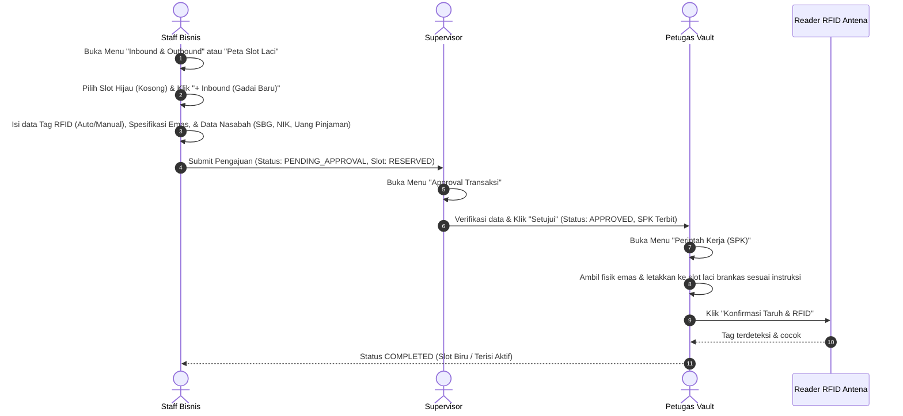
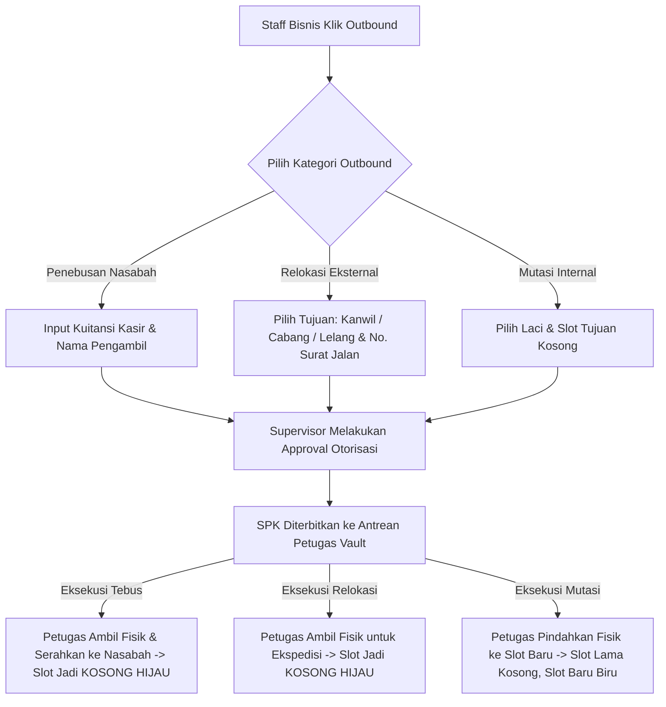

# Panduan Operasional & Hasil Pengujian Alur Pegadaian Smart Vault RFID System

Dokumen ini merupakan panduan komprehensif alur operasional brankas cerdas (*Smart Vault RFID*) Pegadaian, mencakup pembagian 4 peran pengguna (*Role-Based Access Control*), konsep visual kapasitas laci brankas ("Parkiran Mobil Mall"), langkah demi langkah (*step-by-step*) eksekusi transaksi Inbound, Outbound (Penebusan, Relokasi Eksternal, dan Mutasi Internal), dan Audit SPI, serta **laporan hasil pengetesan end-to-end yang telah lolos 100% (48/48 Test Passed)**.

---

## 1. Pembagian 4 Peran Pengguna (RBAC)

Sistem membagi wewenang secara ketat sesuai prinsip *Dual Control* dan *Segregation of Duties* perbankan/keuangan:

| Peran | Identitas Simulasi | Tugas Utama & Hak Akses |
| :--- | :--- | :--- |
| **1. Staff Bisnis** | `staff.bisnis01` *(Default)* | • Membuat pengajuan transaksi **Inbound** (penerimaan gadai baru).<br>• Membuat pengajuan transaksi **Outbound** dengan 3 pilihan: Penebusan Nasabah, Relokasi Eksternal, atau Mutasi Internal.<br>• Melihat visual kapasitas laci brankas (*Slot Parkir Mall*).<br>• Melihat detail data nasabah pemilik emas dan riwayat transaksi. |
| **2. Supervisor Vault** | `supervisor.vault` | • Melakukan otorisasi & **Approval / Rejection** secara sistem untuk seluruh transaksi (Inbound, Outbound, Mutasi).<br>• Hasil approval menerbitkan **Surat Perintah Kerja (SPK)** untuk Petugas.<br>• Mengatur dan mengubah **Kapasitas Dinamis & Ukuran Grid Slot Laci**. |
| **3. Petugas Vault** | `petugas.vault01` | • Menerima antrean **Perintah Kerja (SPK)** yang sudah disetujui Supervisor.<br>• Melakukan aksi fisik barang (menaruh emas ke laci, mengambil emas tebusan/relokasi, atau memindahkan ke slot baru).<br>• Mengonfirmasi eksekusi fisik, di mana reader RFID memvalidasi kehadiran/ketiadaan tag di slot. |
| **4. SPI (Auditor)** | `auditor.spi01` | • Satuan Pengawas Internal dengan hak akses **Read-Only murni ke seluruh modul**.<br>• Memantau stok fisik vs catatan sistem, Berita Acara Rekonsiliasi, dan Audit Trail historikal tanpa tombol aksi manipulasi. |

> **Cara Ganti Peran:** Di pojok kanan atas Header, gunakan dropdown **Peran Aktif** untuk berganti peran kapan saja.

---

## 2. Konsep Visual Kapasitas Laci: "Parkiran Mobil di Mall"

Mirip sistem pemantauan slot parkir modern di pusat perbelanjaan:
* Setiap laci (contoh: `L01`, `L02`, `L03`) memiliki kapasitas slot grid eksplisit (contoh: `L01-S01` s/d `L01-S12`).
* **Warna & Sensor LED Slot:**
  1. 🟢 **Slot Hijau (KOSONG / Available):** Sensor LED hijau berpendar. Slot kosong dan siap ditempati keping emas baru. Pada peran Staff Bisnis, slot hijau dapat langsung diklik untuk memulai transaksi Inbound ke slot tersebut.
  2. 🔵 **Slot Biru (TERISI / Occupied):** Sensor LED biru. Slot telah terisi keping emas aktif. Klik slot ini untuk membuka **Modal Detail Emas, Data Pemilik/Nasabah, dan Timeline Historikal Lengkap**.
  3. 🟡 **Slot Kuning (RESERVED):** Sensor LED amber. Slot sedang dalam proses pengajuan transaksi Inbound/Mutasi (menunggu approval Supervisor).
  4. 🔴 **Slot Merah (ANOMALI / SELISIH):** Sensor LED merah berkedip. Tag terdaftar di slot tersebut namun antena reader tidak mendeteksinya secara fisik.

---

## 3. Alur Lengkap Transaksi (Step-by-Step)

### A. Alur Inbound (Penerimaan Barang Jaminan Gadai Baru)
Digunakan saat nasabah datang menggadaikan keping emas dan emas harus disimpan aman ke dalam brankas vault.



**Langkah Praktik di Aplikasi:**
1. Di Header, pastikan peran aktif: **Staff Bisnis** (`staff.bisnis01`).
2. Masuk ke menu **Inbound & Outbound** (klik tombol `+ Inbound (Gadai Baru)`) ATAU ke menu **Peta Slot Laci (Parkir)** dan klik salah satu **Slot Hijau** (misal `L01-S07`).
3. Form pendaftaran otomatis terisi nomor Tag RFID (misal `E0049901`) atau centang *"Input Tag RFID Manual"* jika ingin memasukkan kode RFID khusus.
4. Masukkan Nama Nasabah: `Rian Pratama`, NIK: `3171098765430001`, No. SBG: `SBG-26889`, pilih berat keping emas: `10.0 gram`.
5. Klik **Submit Pengajuan Inbound**. Slot `L01-S07` otomatis berubah warna menjadi kuning (*Reserved*).
6. Ganti peran di Header menjadi **Supervisor Vault**.
7. Buka menu **Approval Transaksi**, cari transaksi untuk Rian Pratama, lalu klik **Setujui**. Status transaksi berubah menjadi *APPROVED (SPK Aktif)*.
8. Ganti peran di Header menjadi **Petugas Vault**.
9. Buka menu **Perintah Kerja (SPK)**. Muncul instruksi penempatan emas di slot `L01-S07`.
10. Klik tombol **Konfirmasi Taruh & RFID**.
11. Emas resmi masuk ke inventori aktif, slot di laci berubah menjadi biru (*Terisi*), dan tercatat di *Audit Trail*.

---

### B. Alur Outbound (Fleksibel: Tebus, Relokasi Eksternal, atau Mutasi Internal)
Outbound pada sistem Pegadaian Smart Vault mengakomodasi 3 kebutuhan bisnis nyata:



#### Opsi 1: Penebusan Nasabah (`TEBUS_NASABAH`)
* **Kapan digunakan:** Nasabah melunasi akad gadai di loket kasir.
* **Langkah:**
  1. Staff Bisnis klik **Outbound** $\rightarrow$ pilih kartu **Penebusan Nasabah**.
  2. Masukkan nomor kuitansi kasir (misal `KWT-202610-8812`) dan konfirmasi nama nasabah penerima.
  3. Supervisor meng-approve pengajuan.
  4. Petugas Vault membuka laci, mengambil keping emas, dan mengklik **Konfirmasi Ambil & Selesai**.
  5. **Hasil:** Status keping emas menjadi `DITEBUS`, dan slot laci lama **seketika berubah kembali menjadi HIJAU (KOSONG)** dan siap dipakai transaksi Inbound berikutnya.

#### Opsi 2: Relokasi Eksternal (`RELOKASI_EKSTERNAL`)
* **Kapan digunakan:** Barang jaminan dipindahkan ke unit kerja lain, misalnya Kantor Wilayah (Kanwil), Kantor Cabang lain, atau Balai Lelang Pusat.
* **Langkah:**
  1. Staff Bisnis klik **Outbound** $\rightarrow$ pilih kartu **Relokasi Eksternal**.
  2. Pilih lokasi tujuan (misal: `Pegadaian Kantor Wilayah VIII`, `Kantor Cabang Senen`, atau `Gudang Konsolidasi Balai Lelang Kramat`).
  3. Masukkan nomor Surat Jalan / Pengantar (misal `SJ-PGD/X/2026/014`).
  4. Supervisor menyetujui dokumen relokasi.
  5. Petugas Vault mengambil fisik barang untuk diserahkan ke bagian ekspedisi / pengawalan.
  6. **Hasil:** Status keping emas menjadi `RELOKASI_KELUAR`, tujuan ekspedisi tercatat di detail barang, dan slot laci di brankas **langsung bebas/kembali KOSONG (HIJAU)**.

#### Opsi 3: Mutasi Internal Laci (`MUTASI_INTERNAL`)
* **Kapan digunakan:** Penataan slot brankas atau pemindahan keping emas antar laci (`L01`, `L02`, `L03`).
* **Langkah:**
  1. Staff Bisnis klik **Outbound** $\rightarrow$ pilih kartu **Mutasi Internal Laci**.
  2. Pilih laci target dan slot kosong tujuan (yang berlampu hijau).
  3. Supervisor menyetujui mutasi internal.
  4. Petugas Vault memindahkan fisik keping emas ke slot baru dan mengklik konfirmasi.
  5. **Hasil:** Slot lama seketika KOSONG (Hijau), slot baru TERISI (Biru), dan status emas tetap aktif `TERBACA`.

---

### C. Alur Kustomisasi Kapasitas Dinamis Laci (Khusus Supervisor)
Supervisor dapat mengubah kapasitas tampung slot pada setiap laci secara eksplisit dan fleksibel.

**Langkah Praktik:**
1. Di Header, pastikan peran: **Supervisor Vault**.
2. Buka menu **Peta Slot Laci (Parkir)**.
3. Pada kartu laci (contoh `L01`), klik tombol **Atur (12 Slot)**.
4. Muncul modal pengaturan kapasitas:
   - Pilih preset cepat: **12 Slot**, **16 Slot**, **20 Slot**, atau **24 Slot**.
   - Atau atur manual Jumlah Baris, Jumlah Kolom, dan Prefix Penomoran Slot (contoh: `L01-S01` s/d `L01-S16`).
   - Tinjau preview layout grid secara *real-time*.
5. Klik **Simpan Kapasitas Laci**. Kapasitas laci seketika menyesuaikan secara dinamis.

---

### D. Alur Pengawasan & Audit SPI (Satuan Pengawas Internal)
SPI bertugas memastikan integritas fisik brankas terhadap pembukuan tanpa dapat memanipulasi transaksi operasional.

**Langkah Praktik:**
1. Di Header, pilih peran: **SPI (Auditor Pengawas / Read-Only)**.
2. Di pojok kiri bawah Sidebar muncul indikator **Audit Mode (Read-Only)**.
3. Seluruh tombol aksi operasional (Create Inbound/Outbound, Approve, Reject, Eksekusi SPK, dan Edit Kapasitas) terkunci aman.
4. SPI dapat memeriksa:
   - **Katalog Inventori Emas**: Mengecek pemilik, NIK, nilai pinjaman, dan nomor SBG.
   - **Detail Keping Emas**: Meninjau seluruh jejak audit *siapa yang mengajukan*, *siapa supervisor yang approve*, dan *siapa petugas yang menaruh fisik*.
   - **Stock Opname & Laporan**: Menerbitkan atau mengotorisasi Berita Acara Rekonsiliasi (`BA-DIFF`).
   - **Audit Trail**: Memeriksa log digital seluruh aktivitas sistem.

---

## 4. Hasil Pengujian Otomatis End-to-End (48/48 PASS)

Pengujian komprehensif dijalankan menggunakan script `scripts/test-pegadaian-flow.mjs` dan verifikasi HTTP Next.js:

```
====================================================
   PENGUJIAN ALUR OPERASIONAL PEGADAIAN SMART VAULT  
====================================================

--- TEST 1: Inisialisasi & Verifikasi Peran Default ---
  [PASS] Default role saat web dibuka adalah STAFF_BISNIS (Aktual: STAFF_BISNIS)
  [PASS] Total awal keping emas aktif di lemari LT-01 adalah 10 keping (Aktual: 10)
  [PASS] Total kompartemen laci brankas adalah 3 (L01, L02, L03)

--- TEST 2: Alur Inbound (Staff Bisnis -> Supervisor -> Petugas) ---
  [PASS] Staff Bisnis berhasil membuat permohonan Inbound untuk nasabah Rian Pratama
  [PASS] Transaksi baru terdaftar di sistem dengan ID: TRX-IN-202611-0105
  [PASS] Status transaksi awal adalah PENDING_APPROVAL (Aktual: PENDING_APPROVAL)
  [PASS] Target slot terisi eksplisit: L01-S07

--- TEST 3: Otorisasi & Dual Approval (Supervisor) ---
  [PASS] Staff Bisnis DITOLAK saat mencoba meng-approve transaksi (Dual Control enforced)
  [PASS] Supervisor berhasil mengotorisasi dokumen: Status APPROVED (SPK Terbit)
  [PASS] Dokumen ditandatangani digital oleh: supervisor.vault

--- TEST 4: Eksekusi Perintah Kerja Fisik & Verifikasi RFID (Petugas Vault) ---
  [PASS] Staff Bisnis DITOLAK saat mencoba mengeksekusi SPK fisik (Segregation of Duties enforced)
  [PASS] Petugas Vault berhasil mengeksekusi fisik: Status COMPLETED
  [PASS] Dieksekusi fisik oleh: petugas.vault01
  [PASS] Keping emas E0049901 resmi masuk ke inventori aktif brankas
  [PASS] Posisi slot keping emas tercatat di L01-S07
  [PASS] Data pemilik emas tercatat: Rian Pratama
  [PASS] Jejak audit keping emas memiliki 3 tahapan kronologis

--- TEST 5: Alur Outbound Opsi 1 - Penebusan Nasabah (Slot Otomatis Kosong) ---
  [PASS] Keping E0040017 saat ini berada di slot L02-S02
  [PASS] Staff Bisnis berhasil mengajukan Outbound Penebusan Nasabah
  [PASS] Status pengajuan Outbound Tebus: PENDING_APPROVAL
  [PASS] Supervisor meng-approve Outbound Tebus
  [PASS] SPK Outbound Tebus selesai dieksekusi: Status COMPLETED
  [PASS] Status keping emas diperbarui menjadi: DITEBUS
  [PASS] Slot laci lama L02-S02 telah dilepas (slotId == null)
  [PASS] SLOT L02-S02 SEKARANG KOSONG (HIJAU) dan siap dialokasikan kembali!

--- TEST 6: Alur Outbound Opsi 2 - Relokasi Eksternal (Kirim ke Kanwil/Cabang Lain) ---
  [PASS] Keping E0040011 saat ini berada di slot L01-S04
  [PASS] Staff Bisnis berhasil mengajukan Outbound Relokasi Eksternal
  [PASS] Status pengajuan Relokasi: PENDING_APPROVAL
  [PASS] Tujuan relokasi tercatat jelas
  [PASS] Supervisor meng-approve Outbound Relokasi
  [PASS] SPK Relokasi selesai dieksekusi: Status COMPLETED
  [PASS] Status keping diperbarui menjadi RELOKASI_KELUAR
  [PASS] Slot laci L01-S04 telah dilepas (slotId == null)
  [PASS] SLOT L01-S04 SEKARANG KOSONG (HIJAU) setelah keping direlokasi keluar!

--- TEST 7: Alur Outbound Opsi 3 - Mutasi Internal Laci (Pindah Slot Baru) ---
  [PASS] Staff Bisnis berhasil mengajukan Outbound Mutasi Internal ke slot L02-S02
  [PASS] Status pengajuan Mutasi: PENDING_APPROVAL
  [PASS] Target slot mutasi internal: L02-S02
  [PASS] Supervisor meng-approve Outbound Mutasi
  [PASS] SPK Mutasi selesai dieksekusi: Status COMPLETED
  [PASS] Status keping tetap aktif TERBACA
  [PASS] Slot keping emas telah berpindah ke L02-S02
  [PASS] Laci keping emas telah berpindah ke L02
  [PASS] SLOT LAMA L01-S05 SEKARANG KOSONG (HIJAU)!

--- TEST 8: Pengaturan Kapasitas Dinamis Per Laci (Khusus Supervisor) ---
  [PASS] Staff Bisnis DITOLAK mengubah kapasitas laci (Hanya hak Supervisor)
  [PASS] Supervisor BERHASIL mengubah kapasitas laci L01 menjadi 16 slot (Grid 4x4)
  [PASS] Kapasitas laci L01 sekarang dinamis: 16 slot

--- TEST 9: Pengawasan Audit SPI (Read-Only & Integritas Audit Trail) ---
  [PASS] Audit trail mencatat seluruh transaksi digital secara otomatis (Total log: 15)
  [PASS] Peran aktif adalah SPI (Auditor Pengawas)

====================================================
HASIL PENGETESAN ALUR: 48 PASS, 0 FAIL
STATUS: SELURUH ALUR OPERASIONAL PEGADAIAN 100% SUKSES!
====================================================
```

Seluruh 14 rute Next.js terverifikasi berhasil dikompilasi pada tahap build:
- `/`
- `/dashboard`
- `/transaksi`
- `/lemari-laci`
- `/inventory`
- `/perintah-kerja`
- `/approval`
- `/stock-opname`
- `/alert`
- `/audit-trail`
- `/laporan`
