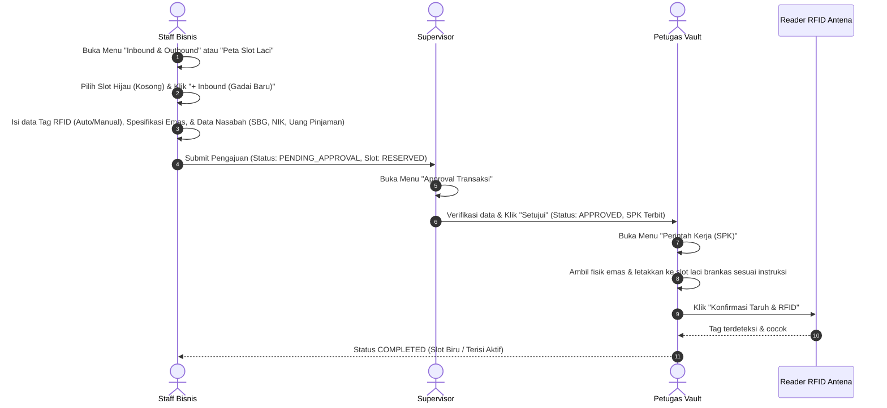
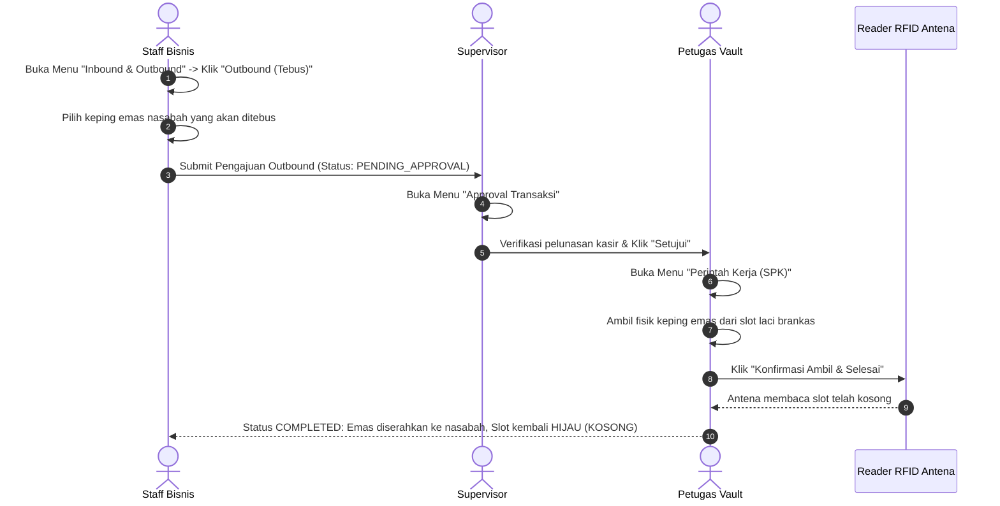

# Panduan Operasional & Alur Bisnis Pegadaian Smart Vault RFID System

Dokumen ini merupakan panduan komprehensif alur operasional brankas cerdas (*Smart Vault RFID*) Pegadaian, mencakup pembagian 4 peran pengguna (*Role-Based Access Control*), konsep visual kapasitas laci brankas, serta langkah demi langkah (*step-by-step*) eksekusi transaksi Inbound, Outbound, Mutasi, dan Audit SPI.

---

## 1. Pembagian 4 Peran Pengguna (RBAC)

Sistem membagi wewenang secara ketat sesuai prinsip *Dual Control* dan *Segregation of Duties* perbankan/keuangan:

| Peran | Identitas Simulasi | Tugas Utama & Hak Akses |
| :--- | :--- | :--- |
| **1. Staff Bisnis** | `staff.bisnis01` *(Default)* | • Membuat pengajuan transaksi **Inbound** (penerimaan gadai baru). • Membuat pengajuan transaksi **Outbound** (penebusan gadai). • Mengajukan **Mutasi** pemindahan lokasi emas. • Melihat visual kapasitas laci brankas (*Slot Parkir Mall*). • Melihat detail data nasabah pemilik emas dan riwayat transaksi. |
| **2. Supervisor Vault** | `supervisor.vault` | • Melakukan otorisasi & **Approval / Rejection** secara sistem untuk seluruh transaksi (Inbound, Outbound, Mutasi). • Hasil approval menerbitkan **Surat Perintah Kerja (SPK)** untuk Petugas. • Mengatur dan mengubah **Kapasitas Dinamis & Ukuran Grid Slot Laci**. |
| **3. Petugas Vault** | `petugas.vault01` | • Menerima daftar **Perintah Kerja (SPK)** yang sudah disetujui Supervisor. • Melakukan pemindahan fisik barang (menaruh emas ke laci atau mengambil emas dari laci). • Mengonfirmasi eksekusi fisik, di mana reader RFID memvalidasi kehadiran/ketiadaan tag di slot. |
| **4. SPI (Auditor)** | `auditor.spi01` | • Satuan Pengawas Internal dengan hak akses **Read-Only murni ke seluruh modul**. • Memantau stok fisik vs catatan sistem, Berita Acara Rekonsiliasi, dan Audit Trail historikal tanpa tombol aksi. |

> **Catatan Penggantian Peran:** Pengguna dapat berpindah peran kapan saja melalui dropdown **Peran Aktif** di Header kanan atas aplikasi.

---

## 2. Konsep Visual Kapasitas Laci: "Parkiran Mobil di Mall"

Mirip sistem pemantauan slot parkir modern di mall:
* Setiap laci (contoh: `L01`, `L02`, `L03`) memiliki kapasitas slot grid eksplisit (contoh: `L01-S01` s/d `L01-S12`).
* **Warna & Status Slot:**
  1. 🟢 **Slot Hijau (KOSONG / Available):** Slot kosong dan siap ditempati keping emas baru. Pada peran Staff Bisnis, slot hijau dapat langsung diklik untuk memulai transaksi Inbound ke slot tersebut.
  2. 🔵 **Slot Biru (TERISI / Occupied):** Slot telah terisi keping emas aktif. Klik slot ini untuk membuka **Modal Detail Emas, Data Pemilik/Nasabah, dan Timeline Historikal Lengkap**.
  3. 🟡 **Slot Kuning (RESERVED):** Slot sedang dalam proses pengajuan transaksi Inbound/Mutasi (menunggu approval Supervisor).
  4. 🔴 **Slot Merah (ANOMALI / SELISIH):** Tag terdaftar di slot tersebut namun antena reader tidak mendeteksinya secara fisik.

---

## 3. Alur Lengkap Transaksi (Step-by-Step)

### A. Alur Inbound (Penerimaan Barang Jaminan Gadai Baru)
Digunakan saat nasabah datang menggadaikan keping emas dan emas harus disimpan aman ke dalam brankas vault.

**Langkah Praktik di Aplikasi:**
1. Di Header, pastikan peran aktif: **Staff Bisnis**.
2. Masuk ke menu **Inbound & Outbound** (klik tombol `+ Inbound (Gadai Baru)`) ATAU ke menu **Peta Slot Laci (Parkir)** dan klik salah satu **Slot Hijau**.
3. Form pendaftaran akan terisi otomatis dengan Tag ID (misal `E0045612`) atau centang "Input Tag RFID Manual" jika ingin ketik manual.
4. Masukkan Nama Nasabah, NIK, No. SBG, dan pilih berat keping emas.
5. Klik **Submit Pengajuan Inbound**. Slot yang dipilih otomatis berubah menjadi kuning (*Reserved*).
6. Ganti peran di Header menjadi **Supervisor Vault**.
7. Buka menu **Approval Transaksi**, cari transaksi Inbound tadi, lalu klik **Setujui**. Status transaksi berubah menjadi *APPROVED / SPK Terbit*.
8. Ganti peran di Header menjadi **Petugas Vault**.
9. Buka menu **Perintah Kerja (SPK)**. Akan terlihat kartu SPK instruksi penempatan emas.
10. Klik tombol **Konfirmasi Taruh & RFID**.
11. Emas resmi masuk ke inventori aktif, slot di laci berubah menjadi biru (*Terisi*), dan tercatat di *Audit Trail*.

---

### B. Alur Outbound (Penebusan Emas & Slot Otomatis Kosong Kembali)
Digunakan saat nasabah telah melunasi pinjaman gadai dan keping emas diserahkan kembali kepada nasabah.

**Langkah Praktik di Aplikasi:**
1. Di Header, pilih peran: **Staff Bisnis**.
2. Buka menu **Inbound & Outbound** $\rightarrow$ klik tombol **Outbound (Tebus)** (atau dari menu Inventori/Peta Laci klik emas terkait $\rightarrow$ klik "Ajukan Outbound").
3. Pilih barang yang ditebus nasabah dan masukkan catatan kasir/pelunasan.
4. Klik **Submit Pengajuan Outbound**.
5. Ganti peran ke **Supervisor Vault**, buka menu **Approval Transaksi**, lalu klik **Setujui**.
6. Ganti peran ke **Petugas Vault**, buka menu **Perintah Kerja (SPK)**.
7. Pada tugas Outbound, klik tombol **Konfirmasi Ambil & Selesai**.
8. **Hasil Langsung:** Keping emas ditandai berstatus `DITEBUS`, slot di laci **langsung berubah kembali menjadi Hijau (Kosong)** dan bisa dipakai untuk transaksi Inbound baru. Riwayat nasabah dan penebusan tetap tersimpan abadi di detail barang.

---

### C. Alur Mutasi Lokasi Emas (Pindah Antar Laci atau Antar Slot)
Digunakan untuk rotasi penataan, konsolidasi gramatur, atau pemindahan kompartemen brankas.

**Langkah Praktik:**
1. Masuk sebagai **Staff Bisnis** atau **Petugas Vault**.
2. Buka menu **Peta Slot Laci** atau **Inventori Emas**, klik tombol **Mutasi** pada keping emas yang ingin dipindahkan.
3. Pilih laci tujuan (contoh: dari `L01` ke `L02`) dan pilih slot kosong yang tersedia (contoh: `L02-S04`).
4. Klik **Submit Mutasi**.
5. Ganti peran ke **Supervisor Vault** $\rightarrow$ buka menu **Approval Transaksi** $\rightarrow$ klik **Setujui**.
6. Ganti peran ke **Petugas Vault** $\rightarrow$ buka menu **Perintah Kerja (SPK)** $\rightarrow$ klik **Konfirmasi Pindah Fisik**.
7. Posisi keping emas resmi berpindah ke slot baru dan tercatat di timeline historikal keping tersebut.

---

### D. Alur Kustomisasi Kapasitas Dinamis Laci (Khusus Supervisor)
Supervisor dapat mengubah kapasitas tampung slot pada setiap laci secara eksplisit dan fleksibel.

**Langkah Praktik:**
1. Di Header, pastikan peran: **Supervisor Vault**.
2. Buka menu **Peta Slot Laci (Parkir)**.
3. Pada kartu laci (contoh `L01`), klik tombol **Atur (12 Slot)**.
4. Muncul modal pengaturan kapasitas:
   - Pilih preset cepat: **12 Slot**, **16 Slot**, **20 Slot**, atau **24 Slot**.
   - Atau atur manual Jumlah Baris, Jumlah Kolom, dan Prefix Penomoran Slot (contoh: `L01-S01` s/d `L01-S20`).
   - Tinjau preview layout grid secara *real-time*.
5. Klik **Simpan Kapasitas Laci**. Kapasitas laci seketika menyesuaikan secara dinamis.

---

### E. Alur Pengawasan & Audit SPI (Satuan Pengawas Internal)
SPI bertugas memastikan integritas fisik brankas terhadap pembukuan tanpa dapat memanipulasi transaksi operasional.

**Langkah Praktik:**
1. Di Header, pilih peran: **SPI (Auditor Pengawas / Read-Only)**.
2. Di pojok kiri bawah Sidebar muncul indikator **Audit Mode (Read-Only)**.
3. Seluruh tombol aksi operasional (Create Inbound/Outbound, Approve, Reject, Eksekusi SPK, dan Edit Kapasitas) terkunci aman.
4. SPI dapat memeriksa:
   - **Katalog Inventori Emas**: Mengecek pemilik, NIK, nilai pinjaman, dan nomor SBG.
   - **Detail Keping Emas**: Meninjau seluruh jejak audit *siapa yang mengajukan*, *siapa supervisor yang approve*, dan *siapa petugas yang menaruh fisik*.
   - **Stock Opname & Laporan**: Menerbitkan atau mengotorisasi Berita Acara Rekonsiliasi (`BA-DIFF`).
   - **Audit Trail**: Memeriksa log digital seluruh aktivitas sistem.

---

## 4. Rangkuman Integrasi & Keunggulan Sistem

1. **Dual Control Terjamin:** Staff Bisnis tidak dapat memindahkan fisik barang secara sepihak; eksekusi fisik mewajibkan otorisasi Supervisor.
2. **Visibilitas Slot Real-Time:** Menghilangkan kebingungan penempatan keping emas dengan peta visual ketersediaan slot layaknya parkiran mall.
3. **Data Kepemilikan & Jejak Audit Lengkap:** Setiap keping emas terikat dengan data lengkap nasabah dan histori pergerakan yang transparan.
4. **Sistem Terverifikasi Bersih:** Kode menggunakan arsitektur modern Next.js 16.4.6, Zustand state management dengan persistensi, dan lolos validasi build tanpa error.
