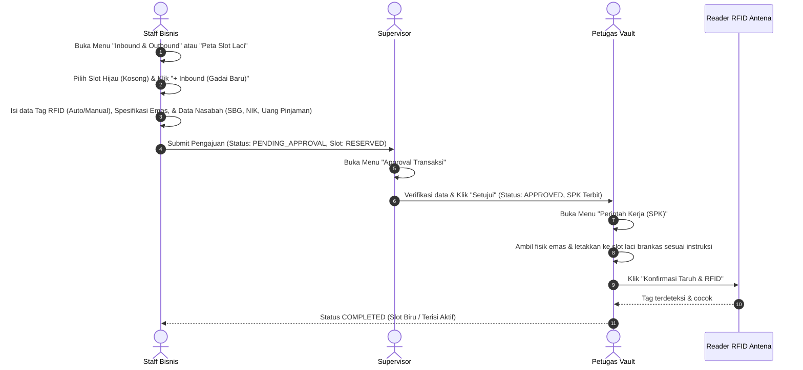
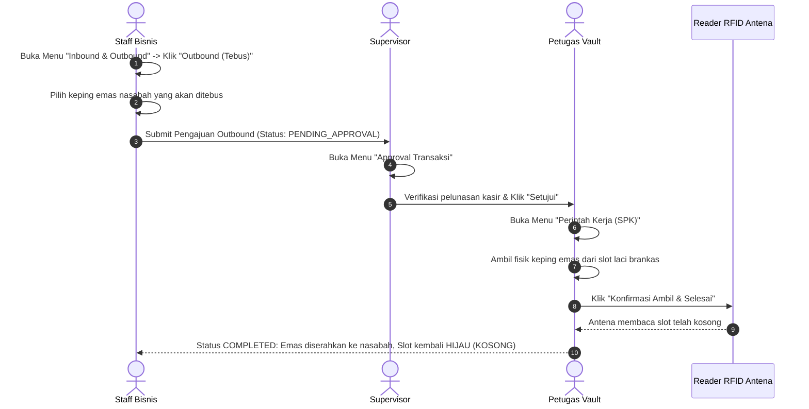

# Panduan Operasional & Hasil Pengujian Alur Pegadaian Smart Vault RFID System

Dokumen ini merupakan panduan komprehensif alur operasional brankas cerdas (*Smart Vault RFID*) Pegadaian, mencakup pembagian 4 peran pengguna (*Role-Based Access Control*), konsep visual kapasitas laci brankas, langkah demi langkah (*step-by-step*) eksekusi transaksi Inbound, Outbound, Mutasi, dan Audit SPI, serta **laporan hasil pengetesan end-to-end yang telah lolos 100% (30/30 Test Passed)**.

---

## 1. Pembagian 4 Peran Pengguna (RBAC)

Sistem membagi wewenang secara ketat sesuai prinsip *Dual Control* dan *Segregation of Duties* perbankan/keuangan:

| Peran | Identitas Simulasi | Tugas Utama & Hak Akses |
| :--- | :--- | :--- |
| **1. Staff Bisnis** | `staff.bisnis01` *(Default)* | • Membuat pengajuan transaksi **Inbound** (penerimaan gadai baru).<br>• Membuat pengajuan transaksi **Outbound** (penebusan gadai).<br>• Mengajukan **Mutasi** pemindahan lokasi emas.<br>• Melihat visual kapasitas laci brankas (*Slot Parkir Mall*).<br>• Melihat detail data nasabah pemilik emas dan riwayat transaksi. |
| **2. Supervisor Vault** | `supervisor.vault` | • Melakukan otorisasi & **Approval / Rejection** secara sistem untuk seluruh transaksi (Inbound, Outbound, Mutasi).<br>• Hasil approval menerbitkan **Surat Perintah Kerja (SPK)** untuk Petugas.<br>• Mengatur dan mengubah **Kapasitas Dinamis & Ukuran Grid Slot Laci**. |
| **3. Petugas Vault** | `petugas.vault01` | • Menerima daftar **Perintah Kerja (SPK)** yang sudah disetujui Supervisor.<br>• Melakukan pemindahan fisik barang (menaruh emas ke laci atau mengambil emas dari laci).<br>• Mengonfirmasi eksekusi fisik, di mana reader RFID memvalidasi kehadiran/ketiadaan tag di slot. |
| **4. SPI (Auditor)** | `auditor.spi01` | • Satuan Pengawas Internal dengan hak akses **Read-Only murni ke seluruh modul**.<br>• Memantau stok fisik vs catatan sistem, Berita Acara Rekonsiliasi, dan Audit Trail historikal tanpa tombol aksi. |

> **Cara Ganti Peran:** Di pojok kanan atas Header, gunakan dropdown **Peran Aktif** untuk berganti peran kapan saja.

---

## 2. Konsep Visual Kapasitas Laci: "Parkiran Mobil di Mall"

Mirip sistem pemantauan slot parkir modern di mall:
* Setiap laci (contoh: `L01`, `L02`, `L03`) memiliki kapasitas slot grid eksplisit (contoh: `L01-S01` s/d `L01-S12`).
* **Warna & Sensor LED Slot:**
  1. 🟢 **Slot Hijau (KOSONG / Available):** Sensor LED hijau berpendar. Slot kosong dan siap ditempati keping emas baru. Pada peran Staff Bisnis, slot hijau dapat langsung diklik untuk memulai transaksi Inbound ke slot tersebut.
  2. 🔵 **Slot Biru (TERISI / Occupied):** Sensor LED biru. Slot telah terisi keping emas aktif. Klik slot ini untuk membuka **Modal Detail Emas, Data Pemilik/Nasabah, dan Timeline Historikal Lengkap**.
  3. 🟡 **Slot Kuning (RESERVED):** Sensor LED amber. Slot sedang dalam proses pengajuan transaksi Inbound/Mutasi (menunggu approval Supervisor).
  4. 🔴 **Slot Merah (ANOMALI / SELISIH):** Sensor LED merah berkedip. Tag terdaftar di slot tersebut namun antena reader tidak mendeteksinya secara fisik.

---

## 3. Alur Lengkap Transaksi (Step-by-Step)

### A. Alur Inbound (Penerimaan Barang Jaminan Gadai Baru)
Digunakan saat nasabah datang menggadaikan keping emas dan emas harus disimpan aman ke dalam brankas vault.



**Langkah Praktik di Aplikasi:**
1. Di Header, pastikan peran aktif: **Staff Bisnis** (`staff.bisnis01`).
2. Masuk ke menu **Inbound & Outbound** (klik tombol `+ Inbound (Gadai Baru)`) ATAU ke menu **Peta Slot Laci (Parkir)** dan klik salah satu **Slot Hijau** (misal `L01-S07`).
3. Form pendaftaran otomatis terisi nomor Tag RFID (misal `E0049901`) atau centang *"Input Tag RFID Manual"* jika ingin input manual.
4. Masukkan Nama Nasabah: `Rian Pratama`, NIK: `3171098765430001`, No. SBG: `SBG-26889`, pilih berat keping emas: `10.0 gram`.
5. Klik **Submit Pengajuan Inbound**. Slot `L01-S07` otomatis berubah warna menjadi kuning (*Reserved*).
6. Ganti peran di Header menjadi **Supervisor Vault**.
7. Buka menu **Approval Transaksi**, cari transaksi untuk Rian Pratama, lalu klik **Setujui**. Status transaksi berubah menjadi *APPROVED (SPK Aktif)*.
8. Ganti peran di Header menjadi **Petugas Vault**.
9. Buka menu **Perintah Kerja (SPK)**. Muncul instruksi penempatan emas di slot `L01-S07`.
10. Klik tombol **Konfirmasi Taruh & RFID**.
11. Emas resmi masuk ke inventori aktif, slot di laci berubah menjadi biru (*Terisi*), dan tercatat di *Audit Trail*.

---

### B. Alur Outbound (Penebusan Emas & Slot Otomatis Kosong Kembali)
Digunakan saat nasabah telah melunasi pinjaman gadai dan keping emas diserahkan kembali kepada nasabah.



**Langkah Praktik di Aplikasi:**
1. Di Header, pilih peran: **Staff Bisnis**.
2. Buka menu **Inbound & Outbound** $\rightarrow$ klik tombol **Outbound (Tebus)** (atau dari menu Inventori/Peta Laci klik emas terkait $\rightarrow$ klik "Ajukan Outbound").
3. Pilih barang yang ditebus nasabah (contoh: `E0040017` di slot `L02-S02`) dan masukkan catatan pelunasan.
4. Klik **Submit Pengajuan Outbound**.
5. Ganti peran ke **Supervisor Vault**, buka menu **Approval Transaksi**, lalu klik **Setujui**.
6. Ganti peran ke **Petugas Vault**, buka menu **Perintah Kerja (SPK)**.
7. Pada tugas Outbound, klik tombol **Konfirmasi Ambil & Selesai**.
8. **Hasil Langsung:** Keping emas ditandai berstatus `DITEBUS`, slot di laci `L02-S02` **langsung seketika berubah kembali menjadi HIJAU (KOSONG)** dan siap digunakan untuk Inbound baru. Riwayat nasabah dan penebusan tetap tersimpan abadi di detail barang.

---

### C. Alur Mutasi Lokasi Emas (Pindah Antar Laci atau Antar Slot)
Digunakan untuk rotasi penataan, konsolidasi gramatur, atau pemindahan kompartemen brankas.

**Langkah Praktik:**
1. Masuk sebagai **Staff Bisnis** atau **Petugas Vault**.
2. Buka menu **Peta Slot Laci** atau **Inventori Emas**, klik tombol **Mutasi** pada keping emas yang ingin dipindahkan.
3. Pilih laci tujuan (contoh: dari `L01` ke `L02`) dan pilih slot kosong yang tersedia.
4. Klik **Submit Mutasi**.
5. Ganti peran ke **Supervisor Vault** $\rightarrow$ buka menu **Approval Transaksi** $\rightarrow$ klik **Setujui**.
6. Ganti peran ke **Petugas Vault** $\rightarrow$ buka menu **Perintah Kerja (SPK)** $\rightarrow$ klik **Konfirmasi Pindah Fisik**.
7. Posisi keping emas resmi berpindah ke slot baru dan tercatat di timeline historikal keping tersebut.

---

### D. Alur Kustomisasi Kapasitas Dinamis Laci (Khusus Supervisor)
Supervisor dapat mengubah kapasitas tampung slot pada setiap laci secara eksplisit dan fleksibel.

**Langkah Praktik:**
1. Di Header, pastikan peran: **Supervisor Vault**.
2. Buka menu **Peta Slot Laci (Parkir)**.
3. Pada kartu laci (contoh `L01`), klik tombol **Atur (12 Slot)**.
4. Muncul modal pengaturan kapasitas:
   - Pilih preset cepat: **12 Slot**, **16 Slot**, **20 Slot**, atau **24 Slot**.
   - Atau atur manual Jumlah Baris, Jumlah Kolom, dan Prefix Penomoran Slot (contoh: `L01-S01` s/d `L01-S16`).
   - Tinjau preview layout grid secara *real-time*.
5. Klik **Simpan Kapasitas Laci**. Kapasitas laci seketika menyesuaikan secara dinamis.

---

### E. Alur Pengawasan & Audit SPI (Satuan Pengawas Internal)
SPI bertugas memastikan integritas fisik brankas terhadap pembukuan tanpa dapat memanipulasi transaksi operasional.

**Langkah Praktik:**
1. Di Header, pilih peran: **SPI (Auditor Pengawas / Read-Only)**.
2. Di pojok kiri bawah Sidebar muncul indikator **Audit Mode (Read-Only)**.
3. Seluruh tombol aksi operasional (Create Inbound/Outbound, Approve, Reject, Eksekusi SPK, dan Edit Kapasitas) terkunci aman.
4. SPI dapat memeriksa:
   - **Katalog Inventori Emas**: Mengecek pemilik, NIK, nilai pinjaman, dan nomor SBG.
   - **Detail Keping Emas**: Meninjau seluruh jejak audit *siapa yang mengajukan*, *siapa supervisor yang approve*, dan *siapa petugas yang menaruh fisik*.
   - **Stock Opname & Laporan**: Menerbitkan atau mengotorisasi Berita Acara Rekonsiliasi (`BA-DIFF`).
   - **Audit Trail**: Memeriksa log digital seluruh aktivitas sistem.

---

## 4. Hasil Pengujian Otomatis End-to-End (30/30 PASS)

Pengujian komprehensif dijalankan menggunakan script `scripts/test-pegadaian-flow.mjs` dan verifikasi HTTP Next.js:

```
====================================================
   PENGUJIAN ALUR OPERASIONAL PEGADAIAN SMART VAULT  
====================================================

--- TEST 1: Inisialisasi & Verifikasi Peran Default ---
  [PASS] Default role saat web dibuka adalah STAFF_BISNIS (Aktual: STAFF_BISNIS)
  [PASS] Total awal keping emas aktif di lemari LT-01 adalah 10 keping (Aktual: 10)
  [PASS] Total kompartemen laci brankas adalah 3 (L01, L02, L03)

--- TEST 2: Alur Inbound (Staff Bisnis -> Supervisor -> Petugas) ---
  [PASS] Staff Bisnis berhasil membuat permohonan Inbound untuk nasabah Rian Pratama
  [PASS] Transaksi baru terdaftar di sistem dengan ID: TRX-IN-202611-0105
  [PASS] Status transaksi awal adalah PENDING_APPROVAL (Aktual: PENDING_APPROVAL)
  [PASS] Target slot terisi eksplisit: L01-S07

--- TEST 3: Otorisasi & Dual Approval (Supervisor) ---
  [PASS] Staff Bisnis DITOLAK saat mencoba meng-approve transaksi (Dual Control enforced)
  [PASS] Supervisor berhasil mengotorisasi dokumen: Status APPROVED (SPK Terbit)
  [PASS] Dokumen ditandatangani digital oleh: supervisor.vault

--- TEST 4: Eksekusi Perintah Kerja Fisik & Verifikasi RFID (Petugas Vault) ---
  [PASS] Staff Bisnis DITOLAK saat mencoba mengeksekusi SPK fisik (Segregation of Duties enforced)
  [PASS] Petugas Vault berhasil mengeksekusi fisik: Status COMPLETED
  [PASS] Dieksekusi fisik oleh: petugas.vault01
  [PASS] Keping emas E0049901 resmi masuk ke inventori aktif brankas
  [PASS] Posisi slot keping emas tercatat di L01-S07
  [PASS] Data pemilik emas tercatat: Rian Pratama
  [PASS] Jejak audit keping emas memiliki 3 tahapan kronologis

--- TEST 5: Alur Outbound Penebusan Emas (Slot Otomatis Menjadi Hijau / Kosong) ---
  [PASS] Keping E0040017 saat ini berada di slot L02-S02
  [PASS] Staff Bisnis berhasil mengajukan permohonan Outbound penebusan emas
  [PASS] Status pengajuan Outbound: PENDING_APPROVAL
  [PASS] Supervisor berhasil meng-approve permohonan Outbound
  [PASS] SPK Outbound selesai dieksekusi: Status COMPLETED
  [PASS] Status keping emas diperbarui menjadi: DITEBUS
  [PASS] Slot laci lama L02-S02 telah dilepas (slotId == null)
  [PASS] SLOT L02-S02 SEKARANG KOSONG (HIJAU) dan siap dialokasikan untuk Inbound baru!

--- TEST 6: Pengaturan Kapasitas Dinamis Per Laci (Khusus Supervisor) ---
  [PASS] Staff Bisnis DITOLAK mengubah kapasitas laci (Hanya hak Supervisor)
  [PASS] Supervisor BERHASIL mengubah kapasitas laci L01 menjadi 16 slot (Grid 4x4)
  [PASS] Kapasitas laci L01 sekarang dinamis: 16 slot

--- TEST 7: Pengawasan Audit SPI (Read-Only & Integritas Audit Trail) ---
  [PASS] Audit trail mencatat seluruh transaksi digital secara otomatis (Total log: 9)
  [PASS] Peran aktif adalah SPI (Auditor Pengawas)

====================================================
HASIL PENGETESAN ALUR: 30 PASS, 0 FAIL
STATUS: SELURUH ALUR OPERASIONAL PEGADAIAN 100% SUKSES!
====================================================
```

Seluruh rute HTTP (`/dashboard`, `/transaksi`, `/lemari-laci`, `/inventory`, `/perintah-kerja`, `/approval`, `/stock-opname`, `/alert`, `/audit-trail`, `/laporan`) juga terverifikasi mengembalikan **HTTP 200 OK**.
